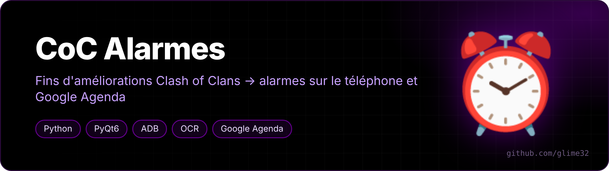
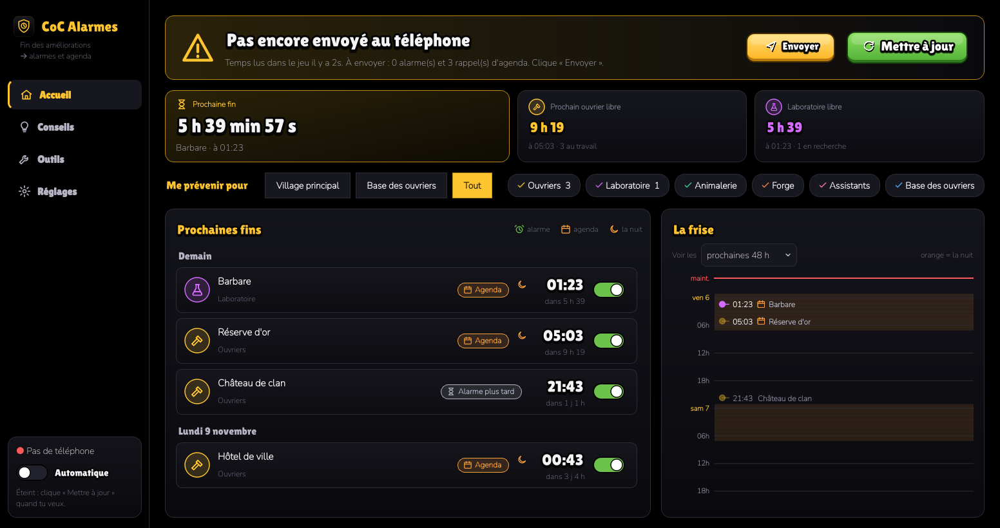
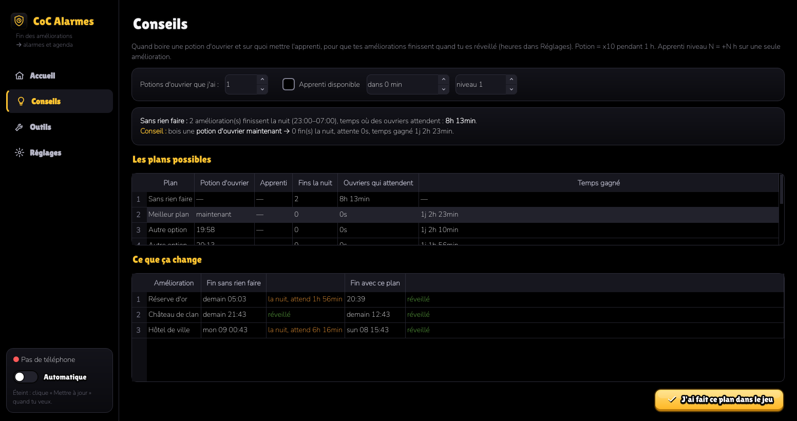
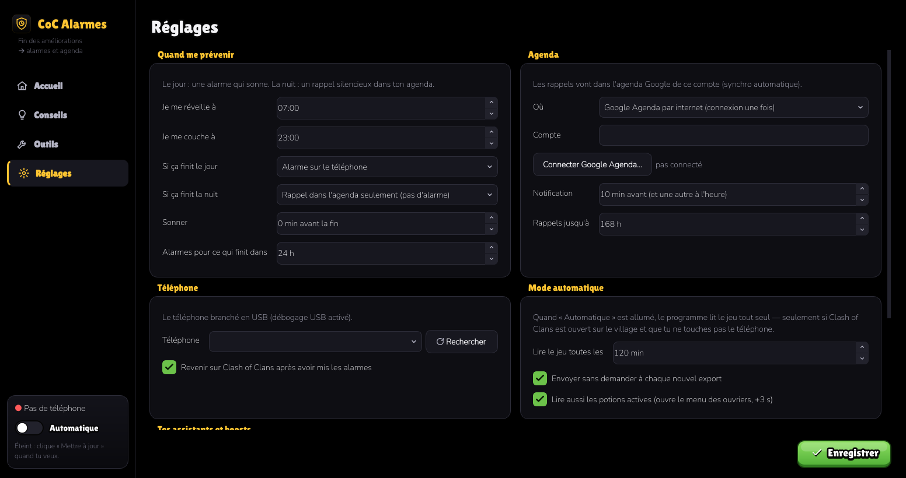

<p align="center"></p>

<p align="center">   </p>

<p align="center"><a href="README.md">🇬🇧 English version</a></p>

**Ne rate plus jamais la fin d'une amélioration Clash of Clans.** CoC Alarmes lit toutes les améliorations en cours de ton village et transforme chacune en alarme sur le téléphone (le jour) ou en rappel silencieux dans Google Agenda (la nuit), à la seconde près, boosts compris.

<p align="center"></p>

## Ce que ça fait

- **Temps exacts** grâce à l'*export de données* officiel du jeu (Paramètres → Plus de paramètres → Export de données → Copier), lu directement dans le presse-papier du téléphone. Sinon, lecture de l'écran par OCR.
- **Boosts pris en compte** : potion d'ouvrier (×10), snack (×2), potions de recherche et d'animaux, tour de l'horloge, apprenti et assistant (+N sur une amélioration pendant 1 h).
- **Jour / nuit** : ce qui finit quand tu es réveillé devient une alarme dans l'Horloge Samsung, ce qui finit la nuit devient un rappel silencieux dans l'agenda (réglable).
- **Conseils** : te dit s'il vaut mieux boire une potion d'ouvrier maintenant (ou où mettre l'apprenti) pour que plus d'améliorations finissent pendant la journée, et combien de temps tu gagnes.
- **Frise** des prochaines 48 h, nuits en orange.
- **Mode automatique** : toutes les N minutes (seulement si Clash of Clans est ouvert sur le village et que tu ne touches pas au téléphone), il copie l'export tout seul et met les alarmes à jour.
- Il ne tape jamais que sur un mot attendu, jamais sur « Supprimer », « Acheter », « Gemmes »…

<p align="center"><br><sub>Page Conseils : quand boire une potion d'ouvrier</sub></p>

## Il faut

- un PC Linux avec Python 3 et `adb` (`android-tools`) ;
- un téléphone Android branché en USB, **débogage USB** activé. Les alarmes passent par l'intent standard `SET_ALARM` ; la suppression des anciennes est faite pour l'Horloge Samsung ;
- en option, Google Agenda (un client OAuth à créer une fois dans Google Cloud Console, l'appli explique comment) ou l'agenda du téléphone.

## Installation

```bash
git clone https://github.com/glime32/coc-alarmes
cd coc-alarmes
./install.sh          # crée .venv, installe les dépendances, ajoute un lanceur au menu
./coc-alarmes
```

<p align="center"></p>

Outil de fan, pas affilié à Supercell. Il lit seulement l'export officiel et l'écran, il ne joue jamais à ta place. Polices : Lilita One et Nunito (SIL Open Font License, voir `polices/`).
