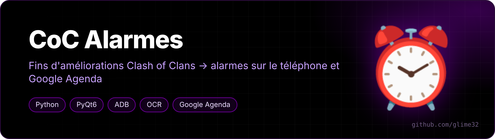
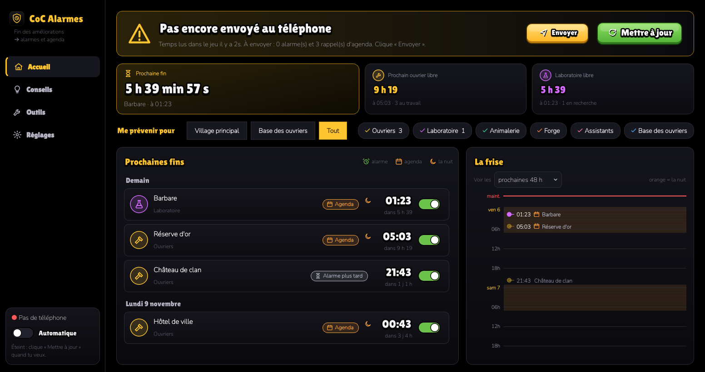
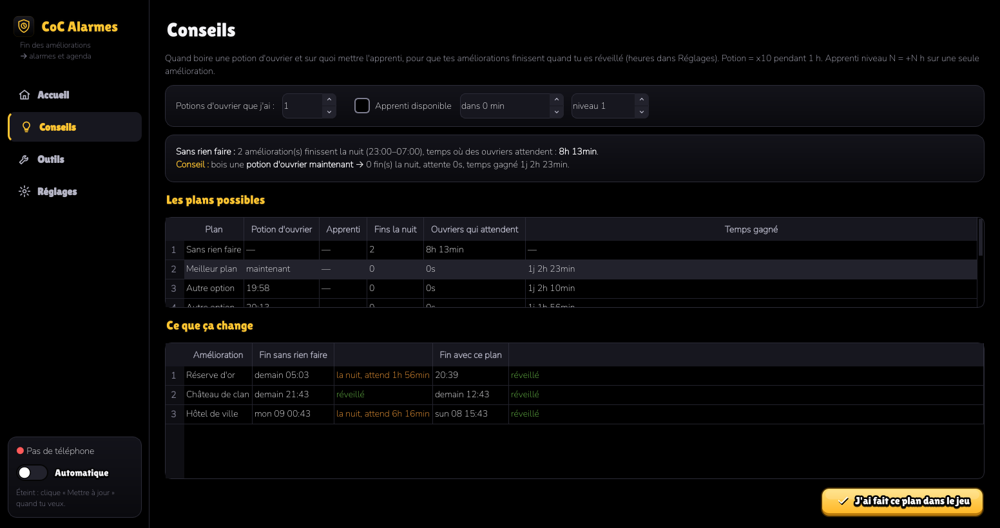
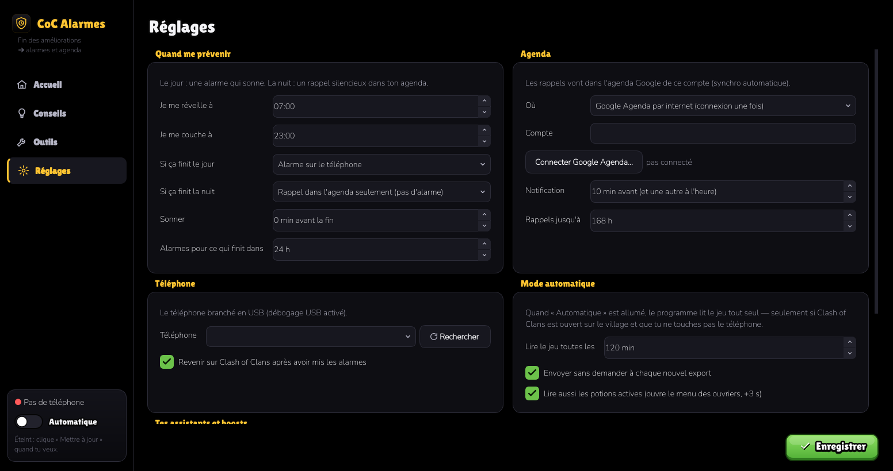

<p align="center"></p>

<p align="center">   </p>

<p align="center"><a href="README.fr.md">🇫🇷 Version française</a></p>

**Never miss the end of a Clash of Clans upgrade again.** CoC Alarmes reads every running upgrade from your village and turns each one into a phone alarm (daytime) or a silent Google Calendar reminder (night) — at the exact second it finishes, boosts included.

<p align="center"></p>

## Features

- **Exact timers** from the game's official *data export* (Settings → More settings → Data export → Copy), read straight from the phone's clipboard. It can also read the screen with OCR as a fallback.
- **Boost-aware**: Builder potions (×10), Builder Bites (×2), research and pet potions, Clock Tower, Apprentice and Lab Assistant (+N on one upgrade for 1 h). The predicted end time accounts for every active boost.
- **Day / night rules**: an upgrade finishing while you're awake becomes an alarm in the Samsung Clock app; one finishing at night becomes a silent calendar reminder instead (configurable).
- **Advice**: tells you whether drinking a Builder potion now (or where to put the Apprentice) makes more upgrades finish while you're awake, and how much time it saves.
- **Timeline** of the next 48 h, with night hours shaded.
- **Automatic mode**: every N minutes (only when Clash of Clans is open on the village and you're not touching the phone), it copies the export by itself and updates the alarms.
- Only ever taps on an expected word — never on "Delete", "Buy", "Gems"…

<p align="center"><br><sub>Advice page: when to drink a Builder potion</sub></p>

## Requirements

- Linux PC with Python 3, `adb` (`android-tools`) and `scrcpy`: its server reads the phone's clipboard and streams the screen as video, much faster than `adb screencap` (~1.2 s per capture), which is still used as a fallback.
- Android phone plugged in over USB with **USB debugging** on. Alarms use the standard `SET_ALARM` intent; removing old alarms is tuned for Samsung's Clock app.
- Optional: Google Calendar (OAuth client created once in Google Cloud Console — the app walks you through it), or the phone's own calendar.

## Install

```bash
git clone https://github.com/glime32/coc-alarmes
cd coc-alarmes
./install.sh          # creates .venv, installs dependencies, adds a menu entry
./coc-alarmes
```

<p align="center"><br><sub>Settings: wake-up / bed time, what to do by day and by night, calendar, automatic mode</sub></p>

Fan-made tool, not affiliated with Supercell. It only reads the official data export and your screen; it never plays for you. Fonts: Lilita One and Nunito (SIL Open Font License, see `polices/`).
